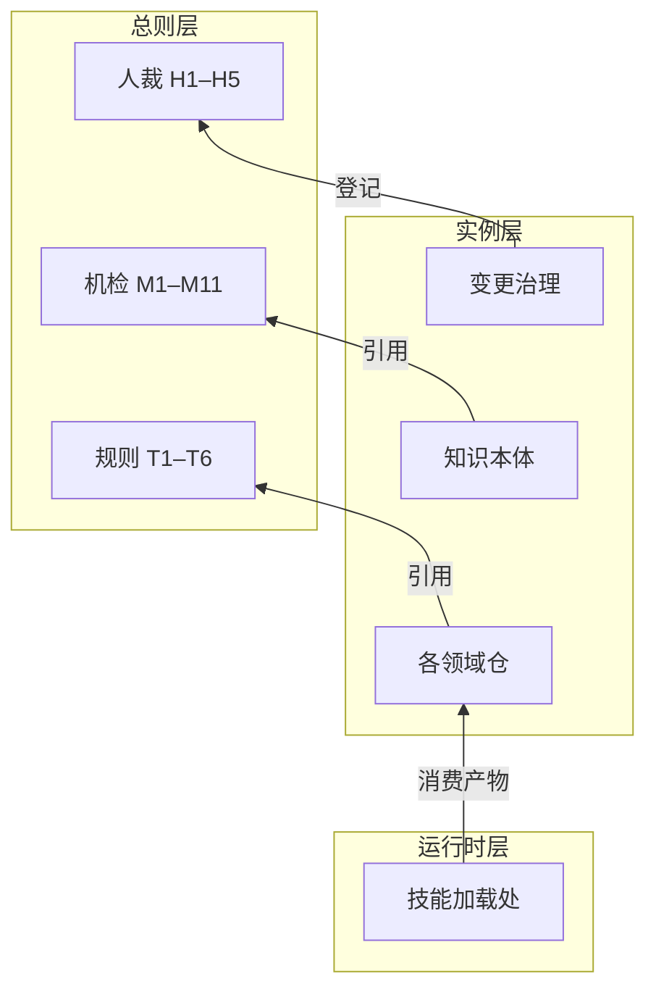
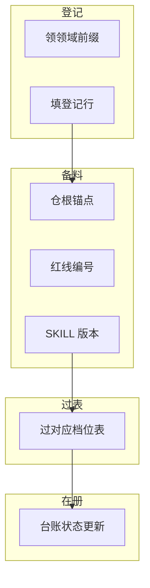
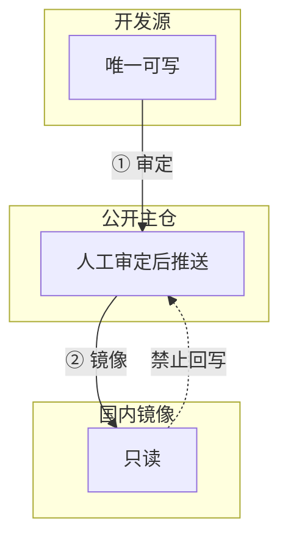

<div align="center">

<h1>repo-mesh · 跨领域治理元仓</h1>

<p>管一批领域仓怎么共存：编号空间 · 接入登记 · 口径裁决 · 发布通道 · 自证</p>

<p>
  
</p>

</div>

> **一句话**：**总则 = 骨架的骨架**。技能定义骨架规范管「**一个**技能文件怎么写」；本总则管「**一批**领域仓怎么共存」。

> **它和普通治理文档的区别**：不是更能写规则，而是**规则能被跑、能被证伪、失败也留痕**。判据是脚本，违反后果是退出码，判据看不见某种形态这件事本身也要登记进公开报告。

> **先看边界**：本仓是**元仓**，不装任何领域内容；也**不是运行时依赖**——接入仓不 import 总则，靠仓根锚点声明路由回来。总则仓不可达时，实例仓照常跑。

> **30 秒验证它是不是真能跑**：`git clone` 后执行 `python validate_governance.py`，退出码 **0=干净 / 2=有发现 / 1=未能执行**。注意第三档：**"没跑成"不会静默当"通过"**。

## 目录

- [它和普通治理文档有什么不同](#它和普通治理文档有什么不同)
- [这是什么：三层，依赖单向](#这是什么三层依赖单向)
- [设计内核：三条铁律](#设计内核三条铁律)
- [治理六件（T1–T6）](#治理六件t1t6)
- [一次接入怎么走](#一次接入怎么走)
- [发布通道：方向唯一](#发布通道方向唯一)
- [验收：机检与人裁分账](#验收机检与人裁分账)
- [配置黑名单](#配置黑名单)
- [谁需要本仓](#谁需要本仓)
- [留痕在哪](#留痕在哪)
- [目录结构](#目录结构)
- [行尾前提](#行尾前提)
- [运行环境](#运行环境)
- [本仓纪律](#本仓纪律)
- [开源口径](#开源口径)
- [已知边界](#已知边界)
- [版本与迭代](#版本与迭代)
- [引用与署名](#引用与署名)

## 它和普通治理文档有什么不同

多数治理仓只有"规则"，没有"规则咬过人"的证据。本仓把自证过程一起留痕——门禁抓到作者自己身上的失实、注入缺陷时被绕过、五次同族过程错误，全部逐条登记在 `reports/`。

| 维度 | 常见的治理文档 | 本仓 |
| --- | --- | --- |
| 规则形态 | 建议、最佳实践 | **判据**：脚本可跑、退出码三值 |
| 违反后果 | 靠自觉 | 门禁退出码 2 |
| 判据失效时 | 静默"全绿" | **检查对象数量为 0 → 退出码 1**：没跑成 ≠ 通过 |
| 新判据上线 | 写完就算 | 必须**注入缺陷**证明它真会报错 |
| 判据的能力边界 | 不说 | 逐条写明，例如「机检只管条文在不在，管不了发布时有没有照做」 |
| 失败记录 | 删掉或改写 | 逐条登记在 `reports/`，公开可见 |

> 一句话概括：**可失败的诚实，是治理机制真正生效的唯一可信标志。**

## 这是什么：三层，依赖单向

| 项 | 值 |
| --- | --- |
| 定位 | 跨领域治理元仓，网状（mesh）而非树状 |
| 管 | 跨仓架构逻辑、编号空间、口径冲突裁决、接入登记、发布通道纪律（T1–T6，全文见 `总则.md` 第三章） |
| 不管 | 任何领域内容。领域知识、判据、门禁全部留在各实例仓 |
| 机检 | `validate_governance.py`，M1–M11，退出码 0／2／1 |
| 人裁 | H1–H5，与机检两本账，不互相抵账 |
| 许可证 | MIT（版权方见 `LICENSE`） |
| 运行时依赖 | **无**。接入仓不 import 总则 |
| 版本 | 见 `总则.md` 版本头与 `git tag --list`——**不在此处维护**，避免同一数字写两处而漂移 |



每层是一个框，框内的短节点就是它装的东西。**依赖只能自下而上**，反向即成「总则依赖实例仓」——那是树状，不是网状。

**一个反直觉但正确的设计**：总则**不是运行时依赖**。接入仓不 import 总则，而是靠仓根锚点声明路由回总则。这意味着总则仓即使不可达，实例仓照常跑——总则不做单点故障。这是网状（mesh）而非树状结构的由来。

**分工判据（一句话）**：换掉领域还成立的，写进总则；换掉领域就不成立的，留在实例仓。

## 设计内核：三条铁律

本仓的取舍不是风格偏好，是三条铁律的直接后果（全文见 `总则.md` §2.2）。

| 铁律 | 一句话 | 在本仓的落点 |
| --- | --- | --- |
| 回读为准 | 「命令成功了」「我改过了」都不算，必须回读产物本身 | 发布以远端回读为准；台账以当次实跑读数为准，不引用历史快照 |
| 闸门须自证 | 新增检查必须故意注入一个缺陷，看它真会报错 | 新判据上线须附缺陷注入记录（`reports/P4`） |
| 零命中先做阳性对照 | 先拿已知有问题的对象跑同一判据；报不出来说明判据坏了 | 「零命中」须先证明判据看得见这种形态（D8／D9 的由来） |

往上还有六条内核 K1–K6（能力外借只自研编排、单一写入入口＋单一台账、标识符全局规范化……，见 `总则.md` §2.1）与三条硬前提（权威源／拍板人／执行环境，见 §2.3——缺一即劝退）。

## 治理六件（T1–T6）

| 编号 | 名称 | 管什么 |
| --- | --- | --- |
| **T1** | 领域编号注册表 | 领域前缀的编号空间，全局不重号 |
| **T2** | 接入登记册 | 一行一仓、单一写入入口；**同时是全局路由表**（路由入口＝各仓仓根锚点声明里的"总则采用版本"） |
| **T3** | 跨仓口径裁决规则 | 两仓口径重叠时：显式登记 → 按优先序裁决 → 结果回填双方 |
| **T4** | 骨架引用与裁剪规则 | 引用不复制；骨架进入新领域前**必须先试套并出缺口清单** |
| **T5** | 发布通道纪律 | 路径唯一、推送前声明、版本打 tag、开源卫生、**公开仓发布必走干净仓单提交** |
| **T6** | 总则自身验收（自举） | 总则自己怎么算合格：机检 + 人裁双账，每次修订后必须实跑 |

条文全文见 `总则.md` 第三章——**本表只作索引，不在两处各写一份**，以免日后漂移。

## 一次接入怎么走



| | **MinSet**（最小接入集） | **FullSet**（完整接入集） |
| --- | --- | --- |
| 目标 | 零脚本可达 | 全套治理闭环 |
| 内容 | 仓根锚点声明、前缀登记、红线 ≥1 条（编号 + 触发条件 + 违反后果）、SKILL.md `version` 字段、动作段、共用声明 | MinSet + 八块骨架、变更定级、接口契约、同步器、门禁脚本、冻结基准、判据三件套 |
| 适用 | 单仓起步、无脚本环境 | 需要跨仓协同、要过机检 |

流程：建仓 → 领域前缀登记 → 填登记行 → 过对应档位验收表。判据详见 `总则.md` 第四章。

**注意末端的"在册"**：过表不等于在册。登记表只登记**事实状态**，不登记计划；动作做完而台账没改，是本仓已登记在案的复发缺陷（见 `冻结基准.md` v1.13.3 节）。

## 发布通道：方向唯一



三点的性质与动作，图里是骨架，细项见下：

| 环节 | 仓 | 可写性 | 到下一环节 |
| --- | --- | --- | --- |
| ① | 开发源 | 唯一可写 | 人工审定后推送 |
| ② | 公开主仓 | 只接受审定的内容 | 单向机械镜像，零内容决策 |
| ③ | 国内镜像 | 只读 | 禁止反向写入（图中虚线） |

**方向唯一，不做双向同步**——双向必然产生冲突与漂移。镜像侧任何手工提交会被下一次推送覆盖，这是设计意图，不是缺陷。

两步的性质不同，这是能否自动化的划界判据：**① 含内容决策**（审什么可公开、什么要脱敏），必须人工；**② 零内容决策**（纯机械同步，一个字节都不改），所以允许自动跑。判据落在"是否含内容决策"，不落在"是否用了自动化工具"。

三点分发关系的完整登记见 `接入登记册.md` §六。

## 验收：机检与人裁分账

- **机检 M1–M11**：能机器判的进 M。退出码三值，**"没跑成"绝不静默当"通过"**（检查对象为 0 时退出码 1）。
- **人裁 H1–H5**：只能人判的进 H。两本账不混，**机检全过 ≠ 合格**。

跑法：

```bash
python validate_governance.py         # 退出码 0=干净 / 2=有发现 / 1=未能执行
```

门禁只校验**条文在不在、格式对不对**，校验不了**发布时有没有照做**——后者发生在仓外的推送动作上。这条边界与其余四项一并列在[已知边界](#已知边界)，不要读作"发布已受机检保护"。

### 配置黑名单

黑名单**不写死在脚本里**——否则本脚本一旦分发，等于把维护者身份与业务领域一并公开。

- 脚本内置**示例值**（占位性质的示例词，非真实内容），保证开箱可跑。
- 使用者按自己情况建 `names.local.json`（已 `.gitignore`）覆盖。**仓内 `names.local.json.example` 是可直接复制的模板**，本 README 不重复内嵌其内容——理由见下方警告。

> ⚠️ **为什么这里不贴一段 JSON 样例**：本仓 M11 扫一切文本文件（含本文），而贴出来的样例词会被使用者
> 原样抄进 `names.local.json` 当黑名单——于是门禁对着 README 里那段样例自己报 FAIL。
> 换任何示例词都躲不开：**在文档里展示配置样例，与"文档也在扫描面内"这两件事不可兼得。**
> 同理，README 里连"示例词长什么样"都不写——**解释这件事本身就会把词写进扫描面。**
> 故样例只放在 `names.local.json.example` 一个文件里，本 README 只给指针。

- 删掉该文件会回落到内置示例值；**不会**变成空名单导致 M8/M9 因"无对象"而 FAIL。
- **但要知道自己此刻在哪个态**：脚本**不会**告诉你当前用的是示例值还是你的真实配置——两种态都输出 PASS。
  判别方法：`names.local.json` 不存在 ⇒ 用的是示例值 ⇒ 你的真实姓名/领域名即使写进仓内也**不会被抓出来**。
  这不是脚本缺陷（它无法自证黑名单是哪一份，见 `总则.md` §4.6 冻结说明），是**流程要求**：发布前先确认该文件在。

## 谁需要本仓

**最终使用者不需要本仓。** 任一领域技能包自包含，获取即用——本总则不是技能的运行时依赖。

| 角色 | 为什么需要 | 拿到什么 |
| --- | --- | --- |
| 新建领域仓的接入者 | 要知道一个仓最少得装哪些东西才叫"接入" | MinSet／FullSet 两档验收表 |
| 跨仓口径冲突的裁决方 | 两个仓对同一件事各说一套时，得有优先序 | T3 裁决规则与冲突登记表 |
| 治理门禁的执行者 | 得跑得动、看得懂、认得出降级态 | 机检 M1–M11 与人裁 H1–H5 两本账 |

路由入口：每个接入仓在仓根锚点声明（判据 A1）中登记"总则采用版本"，该声明**随技能仓自身分发**。要知道某仓归哪版总则管，读该仓自己的锚点声明即可，不需要先拿到本仓。

## 留痕在哪

`reports/` 不是过程垃圾，是本仓的主要证据面。两份记录各自对应一条机制：

| 记录 | 记什么 | 对应机制 |
| --- | --- | --- |
| `P2` 试套报告 | 骨架规范首次跨领域试套：八块骨架逐块对照、缺口清单 | T4 第 3 条「骨架进新领域前必须试套」 |
| `P4` 门禁自证 | 逐判据注入已知缺陷，记录期望与实际退出码；含阴性／阳性对照 | 铁律 2 与铁律 3 |

**失败不删、也不改写**：判据漏检某种形态的结论，与判据生效的结论登记在同一处——只留成功记录的仓，读者无法判断它是否被攻穿过。

## 目录结构

```
repo-mesh/
├── README.md ← 本文件
├── LICENSE                      ← MIT
├── assets/
│   └── badges.svg              ← 首屏徽章（自绘单文件，零外部依赖）
├── 总则.md                       ← T1–T6 治理条文（机检 M1–M11 的对象）
├── 接入登记册.md                  ← 一行一仓，唯一台账（领域名的唯一合法栖身处）
├── validate_governance.py        ← 门禁脚本（退出码 0=干净 / 2=有发现 / 1=未能执行）
├── 冻结基准.md                    ← 版本冻结记录（git blob id 为主判据）
├── 行业专家_跨领域治理总则_策划方案.md ← 演进史：总则怎么来的 + K1–K6 思想底座的唯一落盘载体（非模板）
├── names.local.json.example     ← 黑名单配置模板（**必须**复制为 names.local.json 后改名使用）
├── .gitattributes               ← 行尾钉死 LF（冻结判据跨机器可比的前提）
├── .gitignore                   ← 忽略 names.local.json（它就是维护者身份本身）
├── .github/workflows/
│   └── mirror-to-gitee.yml     ← 单向镜像到 Gitee（push main 触发，显式列 ref，失败完整回显）
└── reports/                     ← 试套报告、门禁自证记录
```

> 目录树说明：`names.local.json` 不在上表——它已被 `.gitignore`，**克隆后不会出现**，须自己创建（见[配置黑名单](#配置黑名单)）。上表逐项与 `git ls-files` 一一对应；缺文件或多文件都算本表过期。

## 行尾前提

仓根 `.gitattributes` 声明 `* text eol=lf`，请保留。本仓的冻结判据以 **git blob id** 为准，而 blob 由字节决定——行尾一变，冻结值即失效，且失效方式很隐蔽：文件看起来一样，判据却对不上。

自验法：`git ls-files --eol` 中文本件应落 `i/lf`。若你的机器设了 `core.autocrlf=true`（Windows 上常见，且可能是全局而非仓库级），删掉或绕过该文件会让清洁克隆的工作树整体转成 CRLF。

## 运行环境

- 门禁脚本为单文件 Python，仅用标准库，无第三方依赖；本机实测环境 Python 3.13。
- 需能读到仓内文件；`--root` 可指向样本目录，用于在副本上跑注入测试而不动正式文件。
- 冻结判据与版本回读若需比对历史，另需 git；门禁本身不依赖 `.git`——公开仓下载 zip 的使用者也要能跑。

## 本仓纪律

1. 依赖单向向下：严禁实例仓反向定义总则规则；严禁总则持有领域内容（正文零领域名，机检 M8）。
2. 引用不复制：沿用外部机制一律走路径引用（台账见 `总则.md` §2.5），禁止复制实例仓治理文件正文。
3. 发布通道唯一；公开仓推送前必须先声明推到哪、谁能看见；推送与否以远端回读为准。
   - **公开仓发布动作的做法不写在本文件**：禁止直接推送本地分支、须用待发布内容另起干净仓单提交——见 `总则.md` T5 第 6 条（**唯一权威表述**，2026-10-20 立）。本处只给指针，不在两处各写一份。
   - **自动化推送的边界（2026-10-08 维护者裁定，修订 T5 第 2 条）**：
     - **仍禁止**：公开仓的**首次创建**、**重大版本发布**、**内容变更的定性**——这些属对外承诺，须人工审定后推送。
     - **允许**：内容经审定入库后，向**已审定镜像目标**的**单向机械镜像**（显式列出要同步的 ref，不含任何内容决策）。**不用 `git push --mirror`**：实测 Gitee 拒绝该命令（`deny updating a hidden ref`）且是部分成功——main 推了、tags 全丢、退出码非 0，而同一命令在 GitHub 侧自测会过。
     - **为什么开这个口子**：纪律要防的是"未经人看一眼就发出去"，不是防"已审定内容的多平台分发"。不分发反而会诱发手工拷贝，直接违反本条第 3 点前半句"发布通道唯一"。
     - **镜像必须单向**：源 → 镜像，镜像侧不得反向写入。方向唯一是"结构上不可能分叉"的唯一保证；双向同步必然产生冲突与漂移。
     - **镜像的代价（须知情）**：镜像侧任何手工提交会被下一次推送覆盖。这是设计意图，不是缺陷。
4. 每次修订后实跑 `validate_governance.py`；新增门禁须做缺陷注入自证；机检与人裁分账，不许互相抵账。
5. **借鉴不产生追平上游的义务**：借鉴外部架构只按需融入逻辑。三问判据——① 本仓是否真的**消费**它（代码依赖/常量引用），还是只借鉴思路？② 本仓该机制的需求是否**内生**？③ 若上游把它删了，本仓会不会**照跑**？三问皆负则不开批。

## 开源口径

总口径：**MIT，版权方见 `LICENSE`；零本机路径、零真名、零项目名、零客户名。**

#### 扫描面与沿革

M11 的扫描面＝**仓内一切文本文件**（按内容判定，不依赖扩展名白名单），**减去 M11 的专属对象（总则、脚本自身）与 `names.local*`**——注意这不等于「冻结四件」：**README 与接入登记册在扫描面内**。

检出形态（v0.11.0 起）：盘符绝对路径（正／反斜杠两种写法）、家目录路径、UNC 共享路径、黑名单词；**占位符只剔除片段本身，不豁免同行其余内容**。

沿革一轮比一轮被动：v0.7.0 由"显式文件名单"改为全仓（原名单漏掉登记册与脚本自身）；v0.8.0 由"后缀白名单"改为按内容判定（原白名单外的配置文件长期零命中）；v0.11.0 修三处豁免与形态缺口（占位符整行豁免、家目录无检查、排除集按文件名匹配）。三轮都是同一件事：**「声明了检查」与「真的在检查」之间的差距，只能靠注入去量。**

#### 依赖：`names.local.json` 必须存在

M8／M9／M11 的禁现能力全部来自它。该文件已 `.gitignore`（它就是维护者身份本身，不该进版本库），**克隆后不会自动出现**；缺失时脚本回落到内置示例值并**照常 PASS**——此时判据形同虚设而门禁显示全绿。按 `总则.md` §4.5「未标注的降级 = 未降级」，该状态应读作**未达标**。判别方法见[配置黑名单](#配置黑名单)。

#### 机检够不到的两层：git 历史与 tag 对象

- **git 历史不在 M11 扫描面内**：M11 扫的是工作树。私有仓转公开时，历史会随分支一并公开，须单独逐提交扫描（`git rev-list main` 逐枚 `git grep`），不能只看 tip。本仓该问题曾以 D8 登记，**已于 v1.8 处置：公开仓历史重建为单一提交，重建前逐提交复扫确认零敏感项**；该做法于 v1.10 升格为 T5 第 6 条硬约束。
- **但「扫提交」扫不到 tag 对象**：附注 tag 是一个**独立的 Git 对象**，`git log -p` 与 `git grep` 都看不见它的 `tagger` 字段。本仓公开仓的 `v1.8` 曾就是附注 tag，其 tagger 里是维护者真实个人邮箱，**已随 tag 分发**——D8 的「零敏感项」只覆盖提交内容，不覆盖这一层。已登记为 **D9**（`总则.md` §4.2.1），**已于 2026-10-25 两端替换为轻量 tag，并回读确认 `^{}` 条目消失**；开发源同名 tag 同步归一。查历史时须另跑 `git cat-file -p refs/tags/<t>` 逐个人工看；新打的 tag 一律用**轻量 tag**（不产生 tag 对象、无 tagger 字段）。

#### 占位符与脱敏边界

文档中的领域名与远端一律用占位符（`{实例仓A}` / `{本仓远端}` 等）。**这是刻意的**：一个跨领域标准若带着某个具体行业的素材，就不是标准，而是某个项目的附件。

**脱敏范围的边界（2026-10-25 明确写出，避免下次再争）**：M9／M11 抓的是**人名／领域名／仓名／本机绝对路径**。**工具链目录名（IDE 与技能加载目录）不在脱敏范围**——它暴露的是"维护者用什么工具"，不是身份、客户或业务领域，且它散落在演进史文档里，改它等于重写史料。这条边界是**判断**不是遗漏：若日后认为需一并脱敏，须先改黑名单，再重扫，不要在文档里逐个擦字（擦字会被下一行绕过，2026-10-08 已实测）。

冻结基准主判据＝ **git blob 对象 id**（内容寻址，与平台／行尾／文件系统无关），辅助＝字节数 + sha256。

## 已知边界

按"读到的绿灯能推出什么"排列，五条都不许被读成更大的覆盖：

| 边界 | 说明 | 出处 |
| --- | --- | --- |
| 机检够不到发布动作 | M1 只校验条文在不在，校验不了推送时有没有照做——推送发生在仓外 | `总则.md` T5 第 6 条、§4.1 M1 第③项 |
| git 历史不在扫描面 | 转公开前须逐提交复扫；本仓已重建为单一提交 | D8 |
| tag 对象扫不到 | 附注 tag 的 `tagger` 独立于内容，须逐个人工看；一律轻量 tag | D9 |
| 跨仓同源无机检判据 | 公开仓与开发源是否同源靠人工回读 tree 对象 id；M1–M11 检查不到 | `接入登记册.md` §六 |
| 机检全过 ≠ 合格 | 人裁 H1–H5 另行裁定，两本账不互相抵账 | `总则.md` §4.2 |

两条补充读数，供判断可信度时使用：**门禁在当前形态下确实会咬人**（首跑即抓到总则自身的判据自指缺陷，见 `reports/P4` §二）；**也曾长时间看不见某些形态**（三轮扫描面收窄，见[开源口径](#开源口径)）。两者同时成立。

## 版本与迭代

- 本仓按语义化版本打 tag；引用请锁定到 tag 或具体 commit（`git describe --tags`），避免跟随 main 拿到中间状态。
- **本文件属冻结四件之一**（总则／接入登记册／README／门禁脚本）：改它须**升版或显式登记**，二选一，不许静默改。取升版而非登记，是为了让公开仓 main 与最新 tag 内容一致。
- 版本变更史在 `冻结基准.md`——它同时充当本仓的 changelog：每节记改了什么、为什么改、当时的冻结值，以及**当时的已知盲区**。
- 冻结值在提交前即可确定的单文件改动，只需一枚提交；改了其他文件时要走「先提交留空 → 读 blob → 回填再提交 → tag 打在回填后那一笔」两枚提交。判据是那一笔有没有可复现的 blob 值可写。

## 引用与署名

本仓库采用 [MIT License](LICENSE)。复制、引用或二次开发请保留版权声明；建议引用格式：

> repo-mesh（跨领域治理元仓）vX.Y.Z，版权方见 `LICENSE`，{本仓远端}
